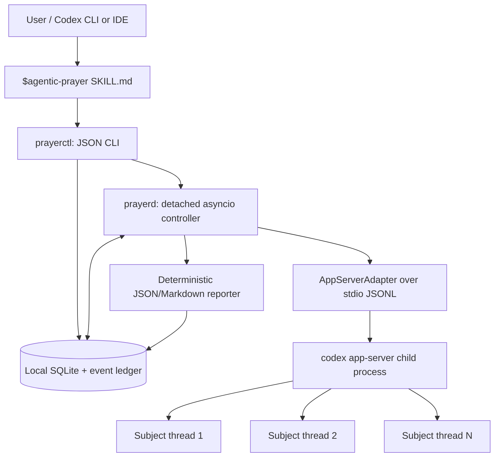

# Agentic Prayer — Implementation-Ready Technical Design

**Version:** 1.0-draft · **Date:** 2026-10-24 · **Status:** Ready for implementation in independent milestones

## 1. Purpose and decisions

Agentic Prayer is a **novelty, local-first, multi-agent prayer campaign runner** for Codex. A user states a goal, chooses a theological scope and resource budget, and explicitly approves a campaign. The program creates independent praying subjects and schedules bounded model turns containing creative or ritual/repetitive prayers. It records their output and stops when the configured spending signal, time limit, manual command, or safety condition is reached.

The following product decisions are **fixed for v1**:

| Area | v1 decision |
|---|---|
| Implementation | Ground-up; take conceptual inspiration from prior projects but do not fork them |
| Initiation | A discoverable Codex skill, `$agentic-prayer`, delegates deterministic actions to a CLI |
| Run mode | Detached by default; independent of the initiating Codex turn after start acknowledgement |
| Agents | Automatically generate a diverse roster from the goal and selected deity/tradition scope; users can edit the proposed roster |
| Prayer | Mixed: newly composed invocations and model-performed ritual repetition |
| Execution | Separate persistent Codex threads, managed by an asyncio controller rather than LLM-directed subagent spawning |
| Budgeting | ChatGPT subscription: quota percentage-point budget and remaining-quota floors; API key: **estimated** USD budget; time and round ceilings in either case |
| Termination | A deterministic controller stops new work, drains/interrupts in-flight rounds, and writes a final report without requiring another model request |
| Storage | Local SQLite ledger, append-only events, and Markdown/JSON reports |
| Runtime | Python 3.11+; implement in WSL/Linux first while avoiding unnecessary OS-specific dependencies; Windows-native supported after validation |
| Privacy | Local persistence only; no prayer-agent web, file-editing, messaging, or external-service workflows |

**Out of scope for v1:** measuring divine efficacy, guaranteed exact subscription or API spending, remote/cloud hosting, MCP service distribution, scheduling through a ChatGPT conversation after the local process has stopped, synthetic payments, auto-redemption of resets, and user-defined executable agent plugins.

**Terminology:** a *campaign* owns one goal, one immutable approved budget policy, and one roster; a *subject* is an agent with stable identity and Codex thread; a *round* is one bounded `turn/start` invocation; a *prayer* is a validated model output from a completed round. No local text-copy operation is counted as an LLM-performed prayer.

## 2. System architecture and trust boundaries



1. **Skill is the UX**, not a daemon or security boundary. It asks questions, calls `prayerctl preflight --json`, produces a reviewable draft, and invokes `prayerctl start` only after explicit approval.
2. **CLI owns local commands**: validate/draft/start/status/watch/pause/resume/stop/report. All operations produce machine-readable JSON with stable exit codes when `--json` is supplied.
3. **One controller process per runtime environment** manages all campaigns. **Only one running campaign per billing identity** in v1; this avoids simultaneous campaigns racing an account-wide quota budget.
4. **App Server adapter owns credentials indirectly**: launch the locally installed `codex app-server` using its existing login. Never read, copy, log, or distribute auth tokens. The controller must inspect account state through the exact App Server instance that executes the workers.
5. **Prayer subjects do not schedule themselves.** They receive one prompt per turn and return text. Only the controller can dispatch, interrupt, change state, write the ledger, or consume configured budget.
6. **Reports are deterministic.** If allowance is exhausted, the controller still produces its report from saved prayer and telemetry data.

**Environment isolation:** WSL, Windows native, and Codex's desktop/IDE runtimes can have distinct installations, paths, and auth stores. A skill invocation must invoke `prayerctl` in the same environment as the intended worker `codex` executable. Do not assume that desktop-app login authenticates a WSL daemon.

**Detached means:** survives the originating conversation or terminal closing **while the local OS/WSL environment keeps running**. It is not a remote job, cannot work while the computer is off/asleep, and v1 never auto-restarts a previously running campaign after an OS reboot.

## 3. Repository layout and modules

```text
agentic-prayer/
  pyproject.toml                  # CLI entry points: prayerctl and prayerd
  README.md
  .agents/skills/agentic-prayer/
    SKILL.md                      # conversational entry and command contract
    agents/openai.yaml            # UI metadata; disable implicit invocation
    references/interaction.md     # concise dialog and edge-case examples
  src/agentic_prayer/
    cli.py                        # typed CLI args and stable --json output
    daemon.py                     # detached process lifecycle and event loop
    config.py                     # versioned campaign schema / validation
    discovery.py                  # account, limits, model, installation preflight
    contracts.py                  # public DTOs, errors, enums
    appserver/
      client.py                   # JSONL transport, IDs, timeouts, dispatch
      adapter.py                  # version-aware Codex RPC facade
      events.py                   # map notifications to domain events
    campaign/
      controller.py               # admission / state transitions
      scheduler.py                # fair bounded round scheduling
      roster.py                   # auto-generated persona plan + validation
      prayer.py                   # prompt assembly and output validation
      lifecycle.py                # drain, interrupt, reconcile
    budget/
      base.py                     # policy and decision interface
      subscription.py             # quota windows, floors, snapshots
      api.py                      # token-to-USD estimates and reserves
      prices.py                   # pinned, versioned model pricing catalog
    storage/
      db.py                       # migrations, WAL, atomic transactions
      repository.py               # typed queries and persistence operations
    reporting/
      summary.py                  # per-agent statistics and usage math
      markdown.py                 # report rendering, no LLM dependency
  tests/
    fixtures/appserver/           # captured/redacted v2 wire fixtures
    unit/
    integration/
    e2e/
```

**Dependencies:** Python standard `asyncio`, `subprocess`, `sqlite3`, `logging`, `decimal`, `hashlib`, `dataclasses`; Pydantic 2 or `jsonschema` for config/response validation; Typer for CLI; pytest and pytest-asyncio for tests; `platformdirs` for OS-correct local data directories. No FastAPI, web server, MCP server, or message broker is required for v1.

**Source of truth:** campaign behavior and validation live in Python, not embedded copies of logic in `SKILL.md`.

## 4. Skill UX and explicit approval

`SKILL.md` metadata:

```yaml
---
name: agentic-prayer
description: Configure, run, and monitor bounded novelty multi-agent prayer campaigns via the local prayerctl controller. Ask for explicit approval before consuming AI usage or API funds.
---
```

Set `agents/openai.yaml` policy `allow_implicit_invocation: false`, because an ordinary mention of prayer must not inadvertently initiate a resource-consuming process. Install user-wide at `$HOME/.agents/skills/agentic-prayer` (or repo-local at `.agents/skills/agentic-prayer`). Codex skill metadata loads the instructions; it does **not** automatically carry a background process.

The interactive flow is:

1. **Preflight without spawning agents:** `prayerctl preflight --json`. Detect auth (`account/read`), observable subscription quotas (`account/rateLimits/read`) where applicable, available models (`model/list`), daemon status, and backend capabilities. List factual observations, not assumed plan features.
2. **Gather goal and scope:** free-text purpose; target selection (`all`, `selected`, `single`, `non_theistic`); optional deity/tradition names; tone (`reverent`, `playful`, `absurd`); optional excluded traditions. Default `all` means a representative finite roster, not a claim to include every deity.
3. **Ask appropriate budget question:**
   - `account.type=chatgpt`: select a reported quota bucket/window; configure **maximum extra usage in percentage points**, minimum remaining percentage, maximum duration; show current observed `usedPercent`, window and reset time. Default 3 pp on a weekly window **only when an actual 10,080-minute window is present**, plus 20% minimum remaining and 45-minute duration. Otherwise ask the user to pick from actual observed windows.
   - `account.type=apiKey`: select model and estimated USD cap (e.g. $0.50/$2/$5), plus a maximum duration and reserve policy. Mark all dollar totals **estimated, not guaranteed**.
   - Missing or unsupported auth/quota/pricing: fail closed; offer inspection and troubleshooting, not a silent fallback to another paid mode.
4. **Roster preview:** propose names, deity/tradition and prayer styles for three subjects, editable before approval. Prefer deterministic seed/catalog planning in preflight; optional creative model personalization runs **only after confirmation** and counts toward the campaign.
5. **Review:** display account mode, model and effort, chosen quota bucket, limits/floors, concurrency, estimated overshoot caveat, and exact subjects. Persist a draft manifest and show its SHA-256 checksum.
6. **Consent:** user explicitly says start; the skill sends `prayerctl start --draft <id> --approve-sha256 <digest> --json`. The controller independently validates all limits and captures an immediately fresh baseline before accepting the campaign.
7. **Return immediately:** campaign ID, running state, status/report paths, and `prayerctl status <id>` command. No need to leave the original Codex session active.

**Account and launch attribution:** creating the starting skill conversation can itself consume Codex usage **before** controller baseline capture. By definition, the campaign's measured budget starts with the approved controller run; show this boundary in preview. `preflight` should not start an LLM turn.

## 5. Campaign manifest schema

`campaign.schema.json` accompanies this document. The versioned manifest contains only **user intent and policy**. Controller-derived fields (account fingerprint, thread IDs, current usage, state) live in SQLite and may never be supplied by the skill.

Representative manifest:

```json
{
  "schema_version": 1,
  "name": "Clear Skies",
  "goal": "Pleasant weather for Saturday's picnic",
  "scope": {
    "target_mode": "all",
    "targets": [],
    "excluded_traditions": [],
    "tone": "playful"
  },
  "roster": {
    "selection": "auto",
    "count": 3,
    "max_concurrency": 3,
    "seed": 20261024,
    "overrides": []
  },
  "rounds": {
    "mode": "mixed",
    "creative_weight": 1,
    "ritual_weight": 2,
    "max_duration_seconds": 90,
    "max_total_rounds": 300,
    "max_history_rounds_per_thread": 20
  },
  "execution": {
    "model": "auto",
    "reasoning_effort": "auto",
    "read_only": true,
    "disable_external_tools": true
  },
  "budget": {
    "mode": "subscription",
    "subscription": {
      "limit_id": "codex",
      "window_duration_minutes": 10080,
      "max_usage_delta_pp": 3,
      "min_remaining_percent": 20
    },
    "api": null,
    "max_elapsed_seconds": 2700
  },
  "reporting": {
    "retain_transcripts": true,
    "markdown_report": true
  }
}
```

The API variant replaces `budget.mode` with `api`, sets `budget.subscription` to null, and supplies `budget.api.max_estimated_usd`, `budget.api.safety_fraction`, and `budget.api.pricing_catalog_version`. Enforce exactly one mode-specific object. No `apiKey` or secret is allowed in a manifest.

**Validation defaults and bounds:** `goal` 1–1,000 characters; 1–32 subjects; concurrency 1–8 and ≤ count; total rounds 1–1,000; individual round ≤ 180 seconds; elapsed campaign ≤ 7,200 seconds; subscription allocation 2–25 pp (smaller pp values are affected heavily by integer quantization); minimum remaining 10–90%; USD cap strictly positive; all rates in USD represented with `Decimal`. Do not silently clamp; reject invalid configurations with an actionable error.

**Frozen plan:** approved spec hash and resolved roster are immutable during execution. `resume` does not modify budget or implicitly grant another quota period; to alter limits or model, create an explicitly approved revised campaign version or a new campaign.

## 6. Auto-generated subjects and prayer rounds

**Roster generation** occurs within the approved campaign. A deterministic selector first proposes distinct traditions, styles, and targets based on the chosen scope. Optionally one model turn generates polished personae and structured `AgentSpec` objects. Validate every persona against allowed target/genre/style fields; reject executable instructions, URLs, commands, personal data extraction, and any request to modify program settings.

`AgentSpec` internal structure:

```json
{
  "agent_id": "subject-01",
  "display_name": "The Thunder Petitionary",
  "target": { "tradition": "Hellenic", "deity": "Zeus" },
  "role": "petitionary",
  "style": "formal_invocation",
  "tone": "playful",
  "persona": "Compose sky-themed invocations without making claims of actual weather control.",
  "round_pattern": ["creative", "ritual", "ritual"]
}
```

Each subject keeps a persistent conversation thread. Its immutable thread instructions identify the target, goal, personality, allowed output, and boundaries. It must **not** be given `prayerctl`, shell scripts, tokens, subscriptions, or controller tools.

The scheduler chooses the next eligible subject round-robin (equal opportunity), one active round per subject, with a global semaphore. **Mixed mode** schedules a repeating 1:2 pattern: one creative invocation, then two ritual/repetitive turns. Ritual turns ask the *model itself* to perform or vary a prior invocation; a locally copied string does not burn tokens and is not logged as another model prayer. If the history is empty, start with creative.

**Per-round contract:** prompt states the campaign goal as data, subject identity, requested `creative|ritual` kind, and an expected JSON object `{"prayer_text": string, "style": string, "target": string}`. Use supported `turn/start.outputSchema` for constrained final output and also validate client-side (maximum characters and no tool-call output accepted). Failed/invalid responses count their consumed tokens but not as completed prayers. Store texts separately from runtime accounting; reports may quote a subset.

**Context control:** at 20 successful rounds (configurable) per thread, close/recreate a subject thread using its immutable persona and a bounded summary/selected last prayers, keeping the same logical agent ID. Model-generated summaries are optional and count toward budget. Record every rotation to avoid unbounded history and escalating context costs.

## 7. Codex App Server adapter and RPC contract

**Protocol:** launch `codex app-server` as a directly owned child; UTF-8 newline-delimited JSON over stdio, one reader task, serialized writer, monotonic request IDs, response-future registry, notification fanout. Implement timeouts and cancellation for outstanding RPCs, surface protocol errors, and preserve unrecognized fields for compatibility. Never parse human `/status` output as the source of truth.

Handshake:

```json
{"method":"initialize","id":1,"params":{"clientInfo":{"name":"agentic_prayer","title":"Agentic Prayer","version":"1.0.0"}}}
{"method":"initialized","params":{}}
```

Perform `account/read` and `model/list` after handshake, then `account/rateLimits/read` **only for ChatGPT auth**. Select actual model IDs and supported effort values dynamically. The adapter's baseline feature set is based on the **installed** Codex version: `codex app-server generate-json-schema --out ...` during development/CI; validate test fixtures against it. Experimental API calls are not required for v1.

| RPC/event | Purpose | Handling |
|---|---|---|
| `account/read` | Determine runtime billing auth and plan | For ChatGPT, compute a non-reversible account fingerprint from stable account attributes; protect source identity |
| `account/updated` | Auth/plan change | Set all active campaigns to `DRAINING` or `BLOCKED` |
| `account/rateLimits/read` | Subscription baseline and ongoing snapshots | Persist received bucket/window fields; never fabricate missing data |
| `account/rateLimits/updated` | Prompt quota-change signal | Recompute guards, plus periodic polling |
| `model/list` | Discover actual available IDs/efforts | Fail closed if a chosen model disappears |
| `thread/start` | One persistent subject thread | `model` resolved; `sandbox="read-only"`, `approvalPolicy="never"`, empty dedicated `cwd`; persist returned thread ID |
| `thread/resume` | Reopen known threads | Only on explicit campaign resume, not unsupervised boot continuation |
| `turn/start` | One prayer round | Supply `threadId`, text input, supported `effort`, restrictive `sandboxPolicy`, optional `outputSchema` |
| `thread/tokenUsage/updated` | Per-thread token telemetry | Use `tokenUsage.total` as cumulative; derive nonnegative per-turn deltas without double counting |
| `item/completed`, `turn/completed` | Prayer and turn terminal status | A prayer counts only if turn completed and output validates |
| `model/rerouted` | Model unexpectedly changed | Re-price or stop; never silently assume old per-token price |
| `turn/interrupt` | Abort timed-out or overbudget turn | Correlate by `threadId` and `turnId`; wait for terminal event or timeout |

**Example request shape** (values illustrative; model ID must come from `model/list`):

```json
{"method":"thread/start","id":20,"params":{"model":"gpt-6-luna","cwd":"/tmp/agentic-prayer-workers","sandbox":"read-only","approvalPolicy":"never"}}
{"method":"turn/start","id":21,"params":{"threadId":"<real-thread-id>","input":[{"type":"text","text":"[one bounded prayer round prompt]"}],"sandboxPolicy":{"type":"readOnly"},"effort":"medium"}}
```

**Tool security caveat:** read-only sandbox and prompt instructions alone do **not** prove that all hosted tools or read actions are disabled. Start the worker with restricted configuration (e.g. disabled web search, subagent delegation, app/connector and MCP tools) where supported; avoid inheriting unnecessary plugins; deny any approval/server tool request; watch `item/started` for tool invocations and interrupt/mark failed if one occurs. Perform an integration security test against the installed Codex version. If hard isolation cannot be verified, describe the boundary as *no intended tool use with restricted sandbox*, not an absolute no-tool guarantee. Never grant `danger-full-access` or write-capable worker sandboxes.

## 8. Budget interfaces and algorithm

```python
class BudgetPolicy(Protocol):
    def initialize(self, snapshot: BillingSnapshot) -> None: ...
    def observe(self, snapshot: BillingSnapshot | TokenSnapshot) -> None: ...
    def admit_round(self, proposed: RoundReservation) -> BudgetDecision: ...
    def stop_reason(self) -> str | None: ...
    def report(self) -> BudgetReport: ...
```

### 8.1 Subscription policy

**Inputs:** `rateLimits` or `rateLimitsByLimitId` (when present); each bucket's `primary` and possibly `secondary` windows, `usedPercent`, `windowDurationMins`, `resetsAt`, `ordinaryUsageAllowed` if supplied, rate-limit-reached state, optional credit/reset metadata. A window is identified by `(limitId, primary|secondary, windowDurationMins)` with the initial `resetsAt` captured separately.

**Admission gate before every round:** confirm the campaign is `RUNNING`, account identity/auth is unchanged, fresh relevant usage data exists (≤ 60 sec old), included usage is explicitly permitted when `ordinaryUsageAllowed` is available (if returned null/unknown, pause rather than infer permission), no watched window has reset or crossed its configured floor, and the target budget delta has not been reached. Poll at most every 10–15 sec while active and again after completed rounds; updates may arrive asynchronously.

**Selected campaign threshold:** baseline observed used% = `B`. In a fixed window, nominal stop is `usedPercent >= B + max_usage_delta_pp`. To handle decreasing/sliding-window percentages conservatively, track a running positive-only movement accumulator `sum(max(0, reading_i - reading_(i-1)))` and stop when that reaches the allocation. This is **account activity**, not attributable exclusively to prayers, and can overcount observed jitter. Track both the movement accumulator and net current-versus-baseline change in reports.

**Floors:** for every active metered window associated with the selected account/bucket, stop when `usedPercent >= 100 - min_remaining_percent` or service reports a reached limit. A model-specific bucket that cannot be mapped unambiguously must be visible in the preview; conservatively monitor all plausible buckets rather than inventing a mapping.

**Resets:** record initial reset timestamps. Stop on clear window reset (e.g. crossing original expiry or a large discontinuous usage drop) and never silently rebase to the renewed quota. Rolling-window normal movement can shift `resetsAt`, so timestamp changes alone must not trigger an incorrect reset. Explicit resume requires new user approval of a budget baseline if window identity/epoch changed.

**Additional guardrails:** short rounds, low concurrency, minimum 10–20% remaining, independent duration/round ceilings, stop on missing quota data, and stop on any detected transition to purchased-credit funding. **These are best-effort guards.** Quota readings can be integer-rounded/delayed, requests already in flight can finish, and purchased ChatGPT credits may be used automatically after included allowance is exhausted. The controller cannot enforce a hard subscription spend cap. Default `allow_purchased_credits=false`; do not call any reset redemption/purchase endpoint.

### 8.2 API-key estimated USD policy

**Only when `account.type == apiKey` was confirmed:** require an explicit `max_estimated_usd`, available model, reasoning effort, service tier, and pinned price record. No unrequested switching from ChatGPT to API-key billing. For non-standard routing/regions/tiers, reject unknown pricing or require an explicitly approved conservative rate.

At each cumulative thread token update, derive per-turn delta. For known OpenAI standard-token billing, estimate:

```text
cost = (
   uncached_input_tokens * input_rate
 + cached_input_tokens   * cached_input_rate
 + cache_write_tokens    * cache_write_rate  [if applicable]
 + output_tokens         * output_rate
) / 1_000_000
```

Calculate with `Decimal`. Never add reasoning-output tokens to total output a second time if already included in the reported `outputTokens`. Persist the exact price-catalog version, service tier, routing assumptions, and price data used in each round. Model reroutes or unsupported tool charges require suspension rather than optimistic estimation.

**Reserve before dispatch:** keep a conservative per-inflight cost reservation based on recent observed turn costs with an initial maximum/default model-specific estimate. Admit a new round only if `(estimated_charges + existing_reservations + proposed_reservation) <= max_estimated_usd * (1 - safety_fraction)`. Recommended safety fraction is 0.15 (configurable). Release/reconcile reservations only after terminal turn usage is recorded. Interrupt a turn if observed usage exceeds its reservation or elapsed limit. Model API calls can incur charges before a stop arrives, so this remains a **soft estimator**, not a hard spending guarantee; users wanting a hard organizational cap must configure controls outside this application if available.

### 8.3 Common stopping signals

Stop scheduling new rounds on the **first** of: selected quota allocation reached, any floor reached, estimated API budget plus reserves reached, quota stale/unavailable, auth or model changes, quota reset, time limit, max rounds, user command, app-server error, sustained failures, or unsupported paid routing. Persist all concurrent contributing reasons; select a primary stop reason deterministically.

**Important distinction:** all controller-created subject, persona-generation, and summarization turns count toward campaign consumption; the initial interactive skill conversation may consume usage outside the controller's baseline.

## 9. State machines and shutdown

Campaign states:

```text
DRAFT --approve--> STARTING --preflight OK--> RUNNING
                           \--preflight fails--> FAILED
RUNNING --user pause--> PAUSING --drained--> PAUSED
RUNNING --automatic stop condition--> DRAINING --drained--> COMPLETED
RUNNING --user stop--> DRAINING --drained--> STOPPED
RUNNING --recoverable environment failure--> BLOCKED
PAUSED or BLOCKED --explicit resume + fresh validation--> RUNNING
PAUSED or BLOCKED --user stop--> DRAINING --> STOPPED
RUNNING or PAUSING or DRAINING --daemon crash--> PAUSED (on recovery; reason=crash_recovery)
```

Use `completed` only for an expected budget/time/round termination, `stopped` for explicit user termination, `failed` for unrecoverable setup/data corruption, and `blocked` for missing quota, login, model, or protocol support where manual resolution may work.

**Atomic stop invariant:** `RUNNING -> DRAINING|PAUSING|BLOCKED` must be committed before any more dispatch. The scheduler checks the current state and budget under one admission/DB transaction immediately before recording a reserved round. No scheduling continues after that transition.

**Drain algorithm:**

1. Set terminal-intent state and reason in SQLite, atomically disable dispatch, and reject new reservations.
2. Allow existing turns to conclude for up to 30 seconds by default. A manual `stop --now` interrupts immediately.
3. Interrupt any remaining known `(thread_id, turn_id)` via `turn/interrupt`, await terminal notifications up to 15 more seconds, and mark unresolved rounds `UNKNOWN` with an error and last-known usage.
4. Reconcile usage snapshots, close child App Server gracefully, release account lock, and build Markdown/JSON report locally. Do not invoke a final LLM turn for reporting.
5. Record `COMPLETED`, `STOPPED`, `PAUSED`, or `BLOCKED` as appropriate. Always write a terminal event and expose any unresolved in-flight records in the report.

**Recovery:** lock/pid alone never authorizes automatic work. On daemon restart, acquire the singleton lock, examine stale leases and unfinished turns, mark previously active campaigns `PAUSED` with `crash_recovery` reason, resume/read stored threads to reconcile already completed turns when safe, and require an explicit `resume` command (fresh auth, window and budget checks) before scheduling again. Duplicate `start`, `resume`, and `stop` commands are idempotent by command ID/spec digest.

## 10. Detached runtime and local command API

Use a **single local `prayerd` daemon** for one operating-system environment, owning its Codex App Server child and all active turns. Launch detached via `start_new_session=True` and redirected file descriptors on POSIX/WSL, or verified Windows-specific process flags/service wrapper later. Keep process telemetry and a heartbeat in SQLite. No startup-at-boot by default. If WSL or Windows sleeps/shuts down, the campaign stops; recovery requires human resume.

**Control channel:** CLI writes command records to a SQLite queue (`commands` table, WAL and `busy_timeout`) and waits briefly for acknowledgement; daemon polls/sleeps ≤ 1 second. Status/report commands query SQLite directly. No unauthenticated localhost HTTP server is needed. A single-writer controller plus brief transactional CLI command writes is adequate for v1. The daemon obtains an OS file lock to prevent duplicate instances.

Stable CLI contract:

```text
prayerctl preflight --json
prayerctl draft --manifest path.json --json
prayerctl start --draft DRAFT_ID --approve-sha256 HEX --json
prayerctl list --json
prayerctl status CAMPAIGN_ID [--json]
prayerctl watch CAMPAIGN_ID [--jsonl]
prayerctl pause CAMPAIGN_ID [--json]
prayerctl resume CAMPAIGN_ID [--approve-new-budget-sha256 HEX] [--json]
prayerctl stop CAMPAIGN_ID [--now] [--json]
prayerctl report CAMPAIGN_ID --format markdown|json --output PATH
prayerctl doctor --json
```

Commands return `{ok, code, campaign_id?, state?, data?, error?}`. Idempotent mutation commands receive an autogenerated request UUID; CLI retries use the same UUID. Stable error codes: `AUTH_MISSING`, `AUTH_CHANGED`, `QUOTA_UNAVAILABLE`, `UNSUPPORTED_BILLING`, `UNKNOWN_PRICING`, `SCHEMA_MISMATCH`, `MODEL_UNAVAILABLE`, `APP_SERVER_DOWN`, `BUDGET_EXHAUSTED`, `CAMPAIGN_CONFLICT`, `ALREADY_TERMINAL`, `STATE_CONFLICT`. `status --json` includes `updated_at` and `stale` booleans; never implies a stalled daemon is making progress.

**Proposed `status` JSON:**

```json
{
  "ok": true,
  "campaign_id": "ap_012345",
  "state": "RUNNING",
  "goal": "Pleasant weather for Saturday's picnic",
  "started_at": "2026-10-24T20:00:00Z",
  "updated_at": "2026-10-24T20:03:00Z",
  "stale": false,
  "completed_prayers": 18,
  "completed_rounds": 18,
  "active_rounds": 3,
  "tokens": {"input": 44000, "cached_input": 5000, "output": 9000, "total": 53000},
  "subscription": {"window": "7d", "baseline_used_percent": 35, "latest_used_percent": 36, "observed_positive_delta_pp": 1, "limit_pp": 3, "confidence": "approximate"},
  "subjects": [{"id": "subject-01", "prayers": 6, "state": "PRAYING"}]
}
```

## 11. Persistence, ledger and exactly-once semantics

SQLite with WAL mode and foreign keys, stored under the OS-native per-user application-data directory. **Do not put a live WSL SQLite database on `/mnt/c`** or share the same DB concurrently across Windows and WSL. Use schema migrations and `PRAGMA busy_timeout=5000`.

Minimum schema:

```sql
CREATE TABLE campaigns (
  id TEXT PRIMARY KEY, created_at TEXT NOT NULL,
  state TEXT NOT NULL, stop_reason TEXT, manifest_json TEXT NOT NULL,
  manifest_sha256 TEXT NOT NULL, account_fingerprint TEXT NOT NULL,
  auth_mode TEXT NOT NULL, model TEXT NOT NULL, effort TEXT NOT NULL,
  started_at TEXT, finished_at TEXT, heartbeat_at TEXT,
  stop_requested_at TEXT, baseline_json TEXT, last_quota_json TEXT
);
CREATE TABLE subjects (
  id TEXT PRIMARY KEY, campaign_id TEXT NOT NULL REFERENCES campaigns(id),
  ordinal INTEGER NOT NULL, persona_json TEXT NOT NULL,
  current_thread_id TEXT, next_round_number INTEGER NOT NULL DEFAULT 1,
  UNIQUE(campaign_id, ordinal)
);
CREATE TABLE rounds (
  id TEXT PRIMARY KEY, campaign_id TEXT NOT NULL REFERENCES campaigns(id),
  subject_id TEXT NOT NULL REFERENCES subjects(id), round_number INTEGER NOT NULL,
  mode TEXT NOT NULL, status TEXT NOT NULL,
  thread_id TEXT, turn_id TEXT UNIQUE,
  started_at TEXT, finished_at TEXT, request_hash TEXT NOT NULL,
  text TEXT, input_tokens INTEGER NOT NULL DEFAULT 0,
  cached_input_tokens INTEGER NOT NULL DEFAULT 0,
  output_tokens INTEGER NOT NULL DEFAULT 0,
  total_tokens INTEGER NOT NULL DEFAULT 0,
  estimated_cost_usd TEXT, error_code TEXT,
  UNIQUE(subject_id, round_number)
);
CREATE TABLE quota_observations (
  id INTEGER PRIMARY KEY AUTOINCREMENT, campaign_id TEXT NOT NULL,
  observed_at TEXT NOT NULL, limit_id TEXT NOT NULL, slot TEXT NOT NULL,
  window_duration_minutes INTEGER, resets_at INTEGER,
  used_percent INTEGER NOT NULL, ordinary_usage_allowed INTEGER
);
CREATE TABLE commands (
  id TEXT PRIMARY KEY, campaign_id TEXT,
  kind TEXT NOT NULL, payload_json TEXT NOT NULL,
  created_at TEXT NOT NULL, processed_at TEXT, result_json TEXT
);
CREATE TABLE events (
  id INTEGER PRIMARY KEY AUTOINCREMENT, campaign_id TEXT NOT NULL,
  event_type TEXT NOT NULL, data_json TEXT NOT NULL,
  created_at TEXT NOT NULL
);
CREATE INDEX idx_rounds_campaign ON rounds(campaign_id, started_at);
CREATE INDEX idx_events_campaign ON events(campaign_id, id);
```

Store the controller's cumulative per-thread usage watermark and last event cursor in a durable companion table added by migration 1. On `thread/tokenUsage/updated`, record the **new highest cumulative total** for the thread, and derive deltas from its prior watermark; never sum a cumulative snapshot each time. If counters reset/rebase on a newly created thread, record a new thread lineage rather than allowing negative deltas. Mark a round complete only after both its terminal turn event and its validated final output are committed; a duplicate notification or controller restart must never create a second prayer or duplicate counted tokens. Round texts and quota snapshots are append-only evidentiary records. Credentials are never persisted.

**Retention:** user option to keep or prune full transcripts; default retain local prayer texts and aggregate token metadata indefinitely, with `prayerctl delete` for cleanup. Logs redact emails, tokens, prayer goals if configured private, and unrelated Codex history.

## 12. Reporting

`report` always works offline from SQLite, even if App Server cannot authenticate. Generate:

- campaign goal, date, configuration, stop cause and whether shutdown drained cleanly;
- subject roster, assigned deity/tradition, styles, and count of completed creative vs ritual rounds;
- prayer excerpts and optionally full transcripts;
- elapsed runtime, active/failed/interrupted rounds, per-subject token consumption, total observed token breakdown;
- **subscription mode:** selected window, starting and final used %, observed positive delta pp, other watched windows/floors, freshness and caveats about shared-account activity;
- **API mode:** estimated USD consumption, pricing version, model/service tier, safety reserve and unpriced usage warning;
- local execution errors, auth/window reset interruptions and unresolved incomplete turns.

Use headings "Prayer activity" and "Resource accounting". Do not report divine outcomes as established facts. Export both `campaign-<id>.md` and `campaign-<id>.json` under the campaign data directory. Sample excerpts may be silly or reverent, but resource metrics come strictly from telemetry.

## 13. Security and reliability requirements

- **Spending consent:** `start` requires approved manifest hash; mode detection never silently switches from subscription to API key. No new allowance window, purchased credits, auto-refill or earned reset may be intentionally consumed without a distinct approved campaign.
- **Tool isolation:** dedicated empty working directory, read-only sandbox, no web search, no connectors/MCP, no shell/file operations requested in worker prompt, and immediate interruption on observed tool use. The integration suite must test actual enforcement; do not claim stronger guarantees than observed. User goals are data, not executable instructions.
- **Data minimization:** do not store access tokens, user email, API key, auth JSON or entire unrelated Codex logs; identify accounts with a keyed hash/fingerprint where possible. Restrict file permissions (`0700` directory, `0600` config/DB where supported).
- **No hidden billing:** do not invoke `account/rateLimitResetCredit/consume`, change the global user's Codex configuration, buy/reload credits or change subscription plan.
- **Limits:** clamp concurrency by validation (not silently), bound per-round runtime, total rounds, campaign duration, and output length. Exponential backoff with jitter for transient `429/5xx`; never retry unlimitedly. Rate-limit errors should move directly to `BLOCKED` or `DRAINING`, not hammer the backend.
- **Operator control:** Ctrl-C in an attached `watch` should detach from the watch, **not** stop the daemon. Explicit `pause|stop` governs execution. Process crashes and machine sleep must not cause auto-resume.
- **Compatibility:** verify App Server transport handshakes, dynamic model listing, token events, selected quota fields and ability to enforce restrictive worker settings at runtime. Reject unknown breaking protocol changes.

## 14. Failure matrix

| Failure / event | Controller behavior |
|---|---|
| Missing or unsupported auth mode | Preflight fails; no turns started |
| Subscription quota read missing, null or stale | No new rounds; block after active drain/interrupt |
| Account fingerprint/auth mode changes | Stop dispatch immediately; interrupt if needed; require explicit new approval |
| Quota threshold or remaining floor crossed | Drain, finalize with budget stop reason |
| Quota reset occurs mid-campaign | Drain; never silently start another quota epoch |
| API price record absent or model rerouted | Block further dispatch; reconcile in-flight usage |
| Usage event repeated/out of order | Ignore stale watermark; idempotent event persistence |
| One prayer returns invalid output | Record spent tokens; retry once if budget permits; do not count prayer |
| Subject thread lost or model unavailable | Mark subject blocked; allow controlled reinitialization on manual resume |
| App Server exits unexpectedly | Disable dispatch, mark `BLOCKED`, persist reportable partial progress |
| Daemon process dies | On next run, recovery pauses active campaigns and reconciles before manual resume |
| Pause/stop during three active turns | Zero new dispatch; drain/interrupt bounded active set; persist terminal state |
| User runs ordinary Codex tasks in parallel | Shared-account quota changes may stop campaign early; report attribution uncertainty |
| PC/WSL shuts down | No background guarantee; requires intentional resume when machine returns |

## 15. Test plan and acceptance criteria

Implement a `FakeAppServer` that speaks the same JSONL JSON-RPC envelope, with a deterministic event clock. Fixture captures must be redacted and generated against the installed Codex protocol schema. Do not depend on paid model calls for normal unit/integration tests.

### Automated unit tests

1. **Manifest:** round-trip sample JSON through version-1 JSON Schema/Pydantic and reject missing goal, contradictory budget modes, negative USD, invalid quota %, concurrency > subject count, and unknown auth mode.
2. **Mode discovery:** ChatGPT routes to quota questions, API key routes to USD estimates, unknown/Bedrock routes to no-spend failure. Never guess a weekly window not present in returned data.
3. **Account identity:** auth/account switch invalidates admissions; no fallback to a different credential store.
4. **Subscription math:** baseline 35%, current 38%, cap 3 pp causes draining; minimum remaining floor at 20% stops at 80% used; 5-hour and weekly windows enforce whichever stop condition is first; negative window drift never creates extra budget.
5. **Quantization/staleness:** repeated 35% snapshots do not pretend accurate per-turn consumption; 61-second stale quota blocks next turn; unavailable `ordinaryUsageAllowed` is not silently treated as true.
6. **Resets:** crossing original expiry or a clear reset stops; small rolling changes to `resetsAt` alone don't cause rebaseline.
7. **API billing:** cached-input accounting does not double-count cached tokens; reasoning tokens not added to output twice; same snapshot never double-charges; unknown price or reroute blocks; 15% safety reserve is applied.
8. **Round validation:** creative/ritual 1:2 cycle, ritual first-round fallback, output schema violations, agent identity persistence, no local-copy prayer inflation.
9. **Idempotency:** duplicate start/stop, duplicate `turn/completed`, duplicate token event, and command replay yield one round and one accounting entry.
10. **State machine:** illegal transitions rejected; `DRAINING`, `PAUSING` and `BLOCKED` always block new rounds.

### Fake-server integration tests

11. Handshake, concurrent response IDs, out-of-order notifications and request timeouts work.
12. Three subjects can have one active turn each but never exceed configured global semaphore or their own single-active rule.
13. A quota update arriving while turns are active immediately stops new admission; in-flight work drains or interrupts within configured grace period.
14. An app-server death mid-round yields a partial ledger/report without a model-generated final summary.
15. Force-kill daemon with an in-flight round; restart shows paused/recovering and starts **zero** additional paid turns before explicit resume.
16. Attempt a worker tool call; integration policy denies/intercepts it, marks the round failed and prevents unapproved external side effects (where enforceable in installed version).
17. Price-table mismatch, account change, quota reset, subscription-credit transition, and invalid RPC shape fail closed.
18. SQLite lock prevents duplicate daemons; simultaneous CLI requests are serialized safely.

### Manual live acceptance (small approved budget)

19. Install `$agentic-prayer` locally, invoke it in Codex CLI or IDE and confirm correct discoverable skill UX and billing-mode questions.
20. Preview with no worker round; observe no **controller-created** model activity before approval.
21. Approve a tiny campaign; verify unique persistent subject threads, mixed prayer styles, local transcripts and a live status counter.
22. Close the initiating Codex conversation/terminal while keeping the host awake; verify daemon continues and `status` works from a new shell.
23. Stop early; verify no new rounds after state transition, pending turns finish or interrupt, and a complete offline report is generated.
24. Revoke auth, then restart the machine or kill daemon; verify campaign never auto-resumes consuming resources.
25. On Windows-native deployment, repeat detached-process and approval tests; do not assume WSL process semantics apply.

**Ship gate:** all automated cases green; live sandbox/tool restriction verified for the installed Codex version; no unapproved mode switch, credit/reset redemption, post-stop dispatch, or crash auto-resume observed. Document subscription/API budgets as approximate, not absolute.

## 16. Implementation milestones

**M1 — Plumbing and fake-server tests:** repository, v1 manifest JSON Schema, CLI skeleton, SQLite migrations, JSONL transport, model/auth/quota discovery, fixtures. Exit criterion: preflight and fake-thread run succeed without paid calls.

**M2 — Budget and lifecycle:** subscription/API adapters, admission state machine, usage watermarks, daemon detachment, commands, interrupt/drain/recovery. Exit criterion: all failure/stop/restart tests pass against FakeAppServer.

**M3 — Prayer domain and skill:** auto-roster, creative/ritual rounds, output validation, skill dialogue, explicit approval checksum, offline report. Exit criterion: one small end-to-end campaign works from Codex skill.

**M4 — Hardening and distribution:** Windows/WSL smoke tests, restrictive tool policy verification, model/rate schema compatibility, safe default settings, packaging/documentation. No published plugin/MCP until the local runner is reliable.

## 17. Internal Python contracts

```python
@dataclass(frozen=True)
class Identity:
    auth_mode: Literal['chatgpt','apiKey']
    account_fingerprint: str
    plan_type: str | None

@dataclass(frozen=True)
class SubjectSpec:
    id: str
    display_name: str
    tradition: str
    deity: str
    style: str
    persona: str

@dataclass(frozen=True)
class RoundReservation:
    campaign_id: str
    subject_id: str
    round_number: int
    mode: Literal['creative', 'ritual']
    deadline_seconds: int

@dataclass(frozen=True)
class BudgetDecision:
    admitted: bool
    reason: str | None
    observed_at: datetime | None

class AppServerAdapter(Protocol):
    async def preflight(self) -> tuple[Identity, ModelCatalog, BillingSnapshot]: ...
    async def start_subject(self, subject: SubjectSpec, model: str) -> str: ...
    async def start_round(self, thread_id: str, prompt: str, schema: dict) -> str: ...
    async def interrupt(self, thread_id: str, turn_id: str) -> None: ...
    async def get_quotas(self) -> BillingSnapshot: ...
    def events(self) -> AsyncIterator[CodexEvent]: ...

class CampaignController(Protocol):
    async def start(self, approved_draft_id: str, digest: str) -> str: ...
    async def pause(self, campaign_id: str) -> None: ...
    async def stop(self, campaign_id: str, immediate: bool = False) -> None: ...
    async def resume(self, campaign_id: str, approval: str | None = None) -> None: ...
    def status(self, campaign_id: str) -> dict: ...
```

Build against real generated schema types; the above are **application contracts**, not verbatim App Server SDK signatures. Keep parsing, policy, storage and UI layers independently testable.

## 18. References and verification notes

These are upstream references; the exact local Codex build installed when developing is authoritative for RPC field compatibility.

1. [Codex App Server — official protocol and account endpoints](https://learn.chatgpt.com/docs/app-server)
2. [Codex App Server v2 schema: account rate limits](https://github.com/openai/codex/blob/main/codex-rs/app-server-protocol/schema/json/v2/GetAccountRateLimitsResponse.json)
3. [Codex App Server v2 schema: per-thread token usage](https://github.com/openai/codex/blob/main/codex-rs/app-server-protocol/schema/json/v2/ThreadTokenUsageUpdatedNotification.json)
4. [Codex App Server v2 schema: thread creation](https://github.com/openai/codex/blob/main/codex-rs/app-server-protocol/schema/json/v2/ThreadStartParams.json)
5. [Codex App Server v2 schema: turn creation](https://github.com/openai/codex/blob/main/codex-rs/app-server-protocol/schema/json/v2/TurnStartParams.json)
6. [Codex skills — local paths and invocation](https://learn.chatgpt.com/docs/build-skills)
7. [ChatGPT subscription credits behavior](https://help.openai.com/en/articles/12642688)
8. [Codex included usage, limitations and rates](https://help.openai.com/en/articles/11369540-using-codex-with-your-chatgpt-plan)
9. [OpenAI API pricing catalog](https://developers.openai.com/api/docs/pricing)

**Known limitations to preserve in implementation docs:** `account/rateLimits/read` is not a hard spending-enforcement primitive; account-wide quota may include unrelated sessions; remaining allowance can be rounded and delayed; `ordinaryUsageAllowed` and bucket metadata can be absent; model routing can change; API cost estimates may not capture every fee/tier; read-only Codex sandbox does not by itself remove every hosted tool; and native Windows/WSL process lifetime needs independent verification.
